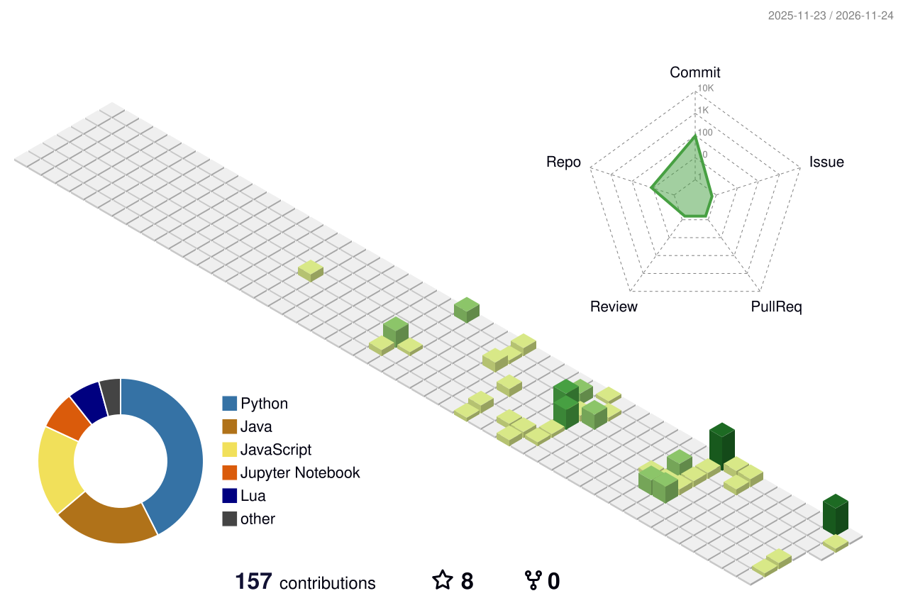
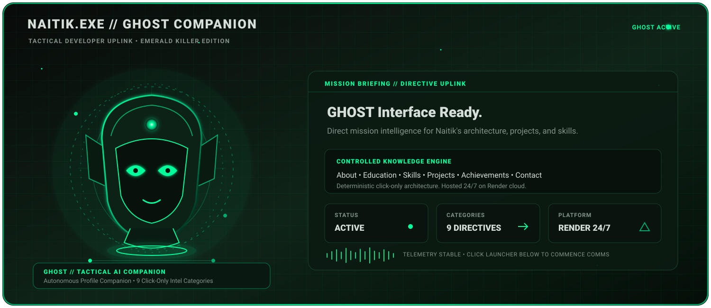

<!-- =================================================================== -->
<!-- NAITIK.EXE // EMERALD KILLER — TOJI FUSHIGURO DEVELOPER UNIVERSE     -->
<!-- Palette: #080A09 (Void) | #10251A (Armor) | #00A86B (Emerald)       -->
<!--          #00FF9C (Bright) | #D5DED8 (Text) | #84928A (Muted)        -->
<!-- =================================================================== -->

<div align="center">

  <!-- 1. TOJI-INSPIRED HERO BANNER -->
  

  <!-- DYNAMIC TYPING SUBTITLE -->
  <a href="https://git.io/typing-svg">
    
  </a>

</div>

<br/>

<!-- 2. NAITIK.EXE IDENTITY AND INTRODUCTION -->
<div align="center">
  <p>
    <b><code>[ CLASS: HEAVENLY RESTRICTION // BUILDER ]</code></b> • 
    <b><code>[ SECTOR: AI & FULL STACK ]</code></b> • 
    <b><code>[ PROTOCOL: EMERALD KILLER ]</code></b>
  </p>
  <p>
    <i>"In a world crowded with sorcery, sharpen your tools, eliminate the noise, and execute with absolute precision."</i>
  </p>
</div>

<div align="center">
  
</div>

<br/>

<!-- 3. WHOAMI DEVELOPER DOSSIER -->
## 🗡️ `SYSTEM BOOT // WHOAMI`

```yaml
identity:
  name: Naitik Bhandari
  callsign: NAITIK.EXE
  github: Fg-naitik
  discipline: B.Tech CSE (Artificial Intelligence & Machine Learning)
  target_timeline: Graduation 2028
  combat_role: Developer | AI/ML Explorer | Product Builder

status:
  current_focus:
    - Artificial Intelligence & Machine Learning
    - Full Stack Application Architecture
    - High-Performance Backend Engineering
  philosophy: "Think. Build. Break. Learn. Repeat."
```

<!-- 4. EDUCATION AND INTERESTS // DEVELOPER HUD -->
<details>
<summary>⚡ <b>Open Developer HUD // Cursed Diagnostics & Interests</b></summary>
<br/>

| MODULE | STATUS | INTEL |
| :--- | :--- | :--- |
| **Academic Base** | <code>AMRAPALI UNIVERSITY</code> | B.Tech CSE (AI & ML) • Class of 2028 |
| **Learning Engine** | <code>RUNNING</code> | Exploring Neural Nets, LLM Systems & Scalable Microservices |
| **Project Lab** | <code>BUILDING</code> | Crafting practical digital tools and user-centric products |
| **Entrepreneurship** | <code>ACTIVE</code> | Startups, disruptive tech & innovative product design |
| **Creative Mode** | <code>ALWAYS ON</code> | UI/UX perfection, manga aesthetics & clean systems |
| **Next Level** | <code>KEEP SHIPPING</code> | Relentless daily improvement through code |

<sub>Achievement unlocked: <i>"Curiosity is your best debugging tool."</i></sub>

</details>

<br/>

<div align="center">
  
</div>

<br/>

<!-- 5. TECHNICAL SKILLS -->
## 🛠️ `ARSENAL // TECHNICAL SKILLS`

<div align="center">

### `> Programming & Languages`


### `> Frameworks, Runtimes & Databases`


### `> Cloud, Deployment & Product Design`


</div>

<br/>

<div align="center">
  
</div>

<br/>

<!-- 6. ANIMATED RPG PLAYER CARD -->
## 🎮 `PLAYER PROFILE // EMERALD KILLER EDITION`

<div align="center">
  
</div>

<br/>

<!-- 7. GITHUB STATISTICS -->
## 📊 `TELEMETRY // GITHUB STATISTICS`

<div align="center">

  <!-- Streak Stats in Emerald Killer Theme -->
  
  <br/><br/>

  <!-- GitHub Stats Extended -->
  <a href="https://github.com/Fg-naitik">
    
  </a>
  <br/><br/>

  <!-- Top Languages Breakdown -->
  <a href="https://github.com/Fg-naitik">
    
  </a>

</div>

<br/>

<!-- 8. 3D CONTRIBUTION GRAPH -->
## 🌌 `3D CONTRIBUTION UNIVERSE`

<div align="center">
  
</div>

<br/>

<!-- 9. CONTRIBUTION SNAKE -->
## 🐍 `CONTRIBUTION GRID SNAKE`

<div align="center">
  
</div>

<br/>

<div align="center">
  
</div>

<br/>

<!-- 10. FEATURED PROJECTS -->
## 🚀 `MISSION ARCHIVES // PROJECT PORTALS`

| MISSION | CLASSIFICATION | TECH FOCUS | REPOSITORY | DEPLOYMENT |
| :--- | :--- | :--- | :---: | :---: |
| **Apna Bank** | AI-Powered Online Banking Platform | Full-Stack Web App, Secure Ledger, JavaScript | [Repository ↗](https://github.com/Fg-naitik/online_banking_system) | [Live App ↗](https://online-banking-system-smoky.vercel.app) |
| **Face Recognition Attendance** | Automated Computer Vision Pipeline | Python, OpenCV, Deep Learning Attendance Tracking | [Repository ↗](https://github.com/Fg-naitik/Face-Recognition-Attendance-System) | `Local Service` |
| **Sync Music** | Real-Time Synchronized Audio Platform | Multi-Device Sync, WebSockets, Audio Streaming | [Repository ↗](https://github.com/Fg-naitik/sync-music-app) | `Local Service` |

<br/>

<!-- 11. GHOST TACTICAL COMPANION LAUNCHER -->
## ☠️ `GHOST // TACTICAL AI COMPANION`

<div align="center">

  <a href="https://naitik-exe-ghost.onrender.com" target="_blank" rel="noopener noreferrer">
    
  </a>

  <br/><br/>

  <a href="https://naitik-exe-ghost.onrender.com" target="_blank" rel="noopener noreferrer">
    
  </a>

  <p>
    <sub><b>TACTICAL DIRECTIVE ENGINE:</b> Click-only intelligence interface with 9 curated directives (About, Education, Skills, Projects, Achievements, Contact). Hosted 24/7 on Render cloud.</sub><br/>
    <sub><i>Note: Initial satellite handshake may take ~40s if waking from free-tier standby.</i></sub>
  </p>

</div>

<br/>

<div align="center">
  
</div>

<br/>

<!-- 12. SOCIAL LINKS & TERMINAL EXIT -->
## 🌐 `SECURE CHANNELS // COMMS`

<div align="center">

  <a href="https://instagram.com/_fuzzy_here_" target="_blank" rel="noopener noreferrer">
    
  </a>
  &nbsp;
  <a href="https://www.linkedin.com/in/naitik-b-7772a8334" target="_blank" rel="noopener noreferrer">
    
  </a>
  &nbsp;
  <a href="https://in.pinterest.com/naitikbhandari63/" target="_blank" rel="noopener noreferrer">
    
  </a>
  &nbsp;
  <a href="mailto:naitikbhandari63@gmail.com">
    
  </a>

  <br/><br/>

  ### `$ exit --but-keep-building`

  <b>"Code is not just about solving problems. It's about creating possibilities."</b>

</div>

<br/>

<!-- 13. FOOTER -->
<div align="center">
  
</div>
